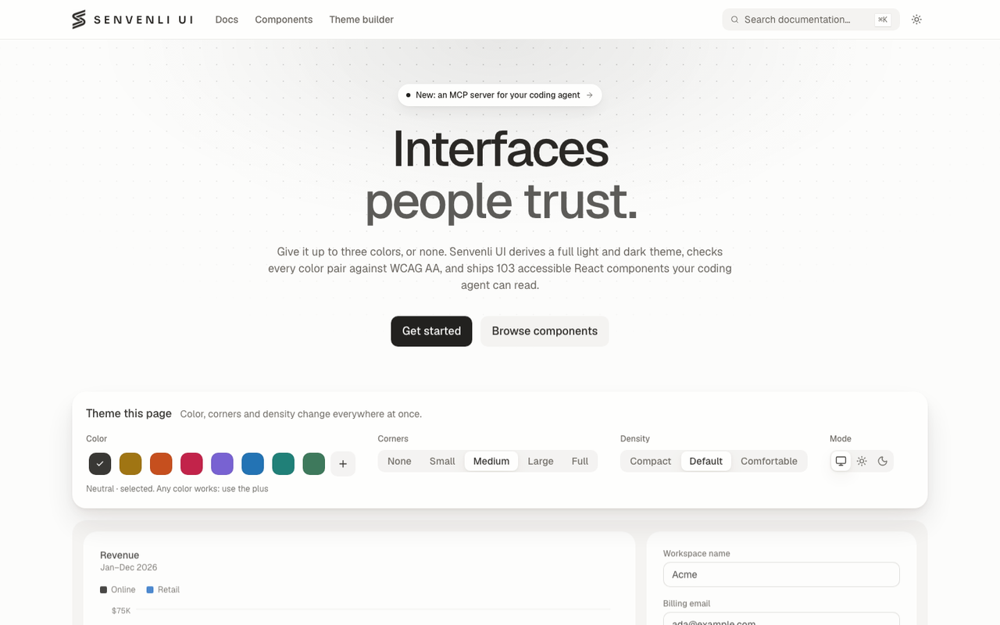

<p align="center">
  <a href="https://design.senvenli.com">
    <picture>
      <source media="(prefers-color-scheme: dark)" srcset=".github/assets/logo-dark.png">
      
    </picture>
  </a>
</p>

<p align="center">
  <strong>Interfaces people trust.</strong><br>
  Pick a color and ship. Senvenli UI gives you accessible React components that look right in light and dark,<br>
  with readable contrast built in, and docs your coding agent can use.
</p>

<p align="center">
  <a href="https://www.npmjs.com/package/@senvenli/react"></a>
  <a href="https://github.com/Senvenli/Senvenli-UI/actions/workflows/ci.yml"></a>
  <a href="LICENSE"></a>
  <a href="https://design.senvenli.com/docs/agents"></a>
</p>

<p align="center">
  <a href="https://design.senvenli.com"><strong>Website</strong></a> ·
  <a href="https://design.senvenli.com/docs/getting-started">Getting started</a> ·
  <a href="https://design.senvenli.com/docs/components">Components</a> ·
  <a href="https://design.senvenli.com/create">Theme builder</a> ·
  <a href="https://design.senvenli.com/docs/agents">For agents</a>
</p>

<p align="center">
  <a href="https://design.senvenli.com">
    <picture>
      <source media="(prefers-color-scheme: dark)" srcset=".github/assets/site-dark.png">
      
    </picture>
  </a>
</p>

## Why Senvenli UI

- **103 accessible components.** Built on React Aria and styled with Tailwind v4. Every component handles keyboard use, focus, screen readers and right-to-left layouts, and formats dates and numbers for the user's locale.
- **A theme from a few inputs.** Give up to three brand colors, plus corners, density and border width. The engine derives everything else: hover and pressed states, text on colored fills, selection, links, charts and the whole dark theme.
- **Contrast you don't have to check.** The engine measures all 128 text and border pairs in light and dark. When a color can't carry its label at AA, it changes the color's lightness until it does and keeps the hue.
- **Neutral by default.** With no colors you get a calm, soft black and white (`#0c0c0b` / `#fcfcfb`), never pure.
- **Ready for coding agents.** Every component ships a machine-readable manifest. A hosted MCP server lets Claude, ChatGPT, Cursor or any MCP client search components, read their real props and generate themes.
- **Native apps share the palette.** The same theme is also available as plain hex values for iOS and Android.

## Quick start

```sh
npm i @senvenli/react
npx @senvenli/cli theme --primary "#1268ae" --tailwind --out src/theme.css
```

```css
/* your app's stylesheet */
@import "tailwindcss";
@import "./theme.css";
@import "@senvenli/react/theme.css";
@import "@senvenli/react/base.css";
@source "../node_modules/@senvenli/react/dist";
```

```tsx
import { DesignSystemProvider } from "@senvenli/react";
import { Button } from "@senvenli/react/action";
import { Input } from "@senvenli/react/form";

export function App() {
  return (
    <DesignSystemProvider locale="en">
      <form>
        <Input label="Full name" />
        <Button type="submit" variant="primary">Save changes</Button>
      </form>
    </DesignSystemProvider>
  );
}
```

[Getting started](https://design.senvenli.com/docs/getting-started) has the full walkthrough, including routing and dark mode without a flash. To pick colors visually, use the [theme builder](https://design.senvenli.com/create).

## Connect your agent

Add the hosted server to your MCP client:

```json
{
  "mcpServers": {
    "senvenli-ui": { "type": "http", "url": "https://design.senvenli.com/mcp" }
  }
}
```

It answers with components, examples, docs and AA-checked themes. To run the server locally instead, use `npx -y @senvenli/mcp`. [Agents and AI](https://design.senvenli.com/docs/agents) covers setup for Claude Code, Cursor, VS Code and other clients.

## Packages

| Package | Version | What it is |
|---|---|---|
| [`@senvenli/react`](packages/react) | [](https://www.npmjs.com/package/@senvenli/react) | 103 web components on React Aria and Tailwind v4, with machine-readable manifests |
| [`@senvenli/tokens`](packages/tokens) | [](https://www.npmjs.com/package/@senvenli/tokens) | The theme engine: inputs → AA-checked tokens → CSS or native hex. Installed with `@senvenli/react` |
| [`@senvenli/cli`](packages/cli) | [](https://www.npmjs.com/package/@senvenli/cli) | `npx @senvenli/cli theme` writes your theme files |
| [`@senvenli/mcp`](packages/mcp) | [](https://www.npmjs.com/package/@senvenli/mcp) | MCP server for coding agents: components, docs and themes |
| [`site`](site) | | Docs, component pages and the theme builder at [design.senvenli.com](https://design.senvenli.com) |

## Development

```sh
pnpm install
pnpm build       # the packages
pnpm test        # unit tests, including the AA contrast sweep
pnpm dev         # the site at http://localhost:5173
```

Changes go through pull requests, and `main` requires the CI check to pass. [RELEASE.md](RELEASE.md) describes how to release. To report a vulnerability, see [SECURITY.md](SECURITY.md).

## License

[MIT](LICENSE) © [Senvenli](https://senvenli.com)
